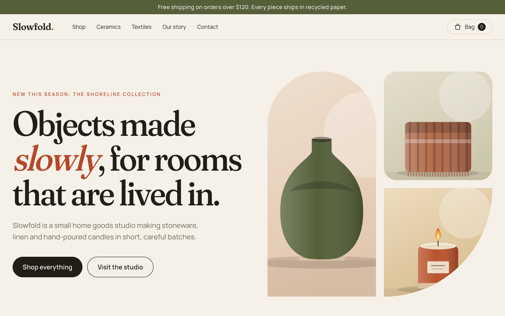

# Slowfold: Next.js ecommerce template

A static Next.js ecommerce storefront with a catalog, product variants, a cart and checkout through hosted payment links, so it needs no server.



[](https://console.cloudzyro.com/new?repo=https://github.com/Cloudzyro/template-ecommerce)

## What's included

- Home page with hero, category tiles, featured products and a brand story
- Shop page with category filters, search and sorting (links like `/shop/?category=ceramics` land filtered)
- A page for every product, generated from one data file, with color and size options, a gallery of colorways, details and related products
- A cart (the "bag") saved in the browser's localStorage, in an accessible slide-over drawer (Escape closes it, focus stays inside while it's open)
- Checkout through hosted payment links (Stripe Payment Links, Paddle, Lemon Squeezy or similar), set per product and optionally per variant
- About page and a contact page with FAQ and a form that posts to a form service of your choice
- Product structured data, Open Graph tags, sitemap, robots.txt and favicon
- Light and dark color schemes, responsive down to 360px, reduced motion respected
- Product images are SVG illustrations drawn in code, so there are no photos to license

## Run it locally

```bash
pnpm install
pnpm dev        # http://localhost:3000
pnpm build      # static site in out/
```

## Make it yours

- **Products:** `data/products.ts` holds categories and products (name, price, description, details, colors, sizes, payment link). Pages, the sitemap and filters update by themselves.
- **Store details:** `data/site.ts` holds the store name, tagline, menu, announcement bar, footer, email, address and FAQ.
- **Payments:** this template doesn't take card details itself. Create a payment link for each product in Stripe (Payment Links), Paddle or Lemon Squeezy, and put it in `paymentLink`. For a different link per option, add `variantLinks` keyed by the option as shoppers pick it, for example `"Ember"`, `"14 oz"` or `"Ember / 14 oz"`. Turn on adjustable quantity in your provider so shoppers can confirm quantities there.
  - When the bag holds one product (any quantity), Check out goes to that product's link.
  - When it holds products with different links, the bag goes to `storeCheckoutUrl` in `data/site.ts` if you set one (for example a single Stripe Payment Link that includes several products), and otherwise shows a Pay button next to each item.
  - The placeholder links in the data file are examples and won't open a real checkout until you replace them.
- **Contact form:** set `NEXT_PUBLIC_FORM_ENDPOINT` to a form endpoint from Formspree, Basin, a Supabase function or similar. The form sends `name`, `email`, `order` and `message` as form data. With no endpoint set, the form shows a short note and opens the visitor's email app addressed to the email in `data/site.ts`.
- **Site address:** set `NEXT_PUBLIC_SITE_URL` (for example `https://shop.example.com`) so the sitemap and social previews use your domain.
- **Colors and fonts:** colors are CSS variables at the top of `app/globals.css` (light and dark). Fonts are Fraunces and Manrope, loaded with `next/font` in `app/layout.tsx`.
- **Product images:** `components/ProductArt.tsx` draws each product type. To use photos instead, swap it for an `` with your own files in `public/`.
- **Social preview image:** replace `public/og.png` (1200 x 630).

Environment variables are read at build time. Locally, put them in `.env.local`:

```bash
NEXT_PUBLIC_FORM_ENDPOINT=https://formspree.io/f/your-id
NEXT_PUBLIC_SITE_URL=https://shop.example.com
```

## Deploy

Click the Deploy button above, or push your own copy to GitHub and connect it in the Cloudzyro console. Add the environment variables in your site's settings. The build command is `pnpm build` and the output folder is `out/`, a plain static site.

## Stack

- Next.js 16 with static export (`output: "export"`)
- React 19
- Tailwind CSS 4
- TypeScript

MIT licensed. See [LICENSE](./LICENSE).
